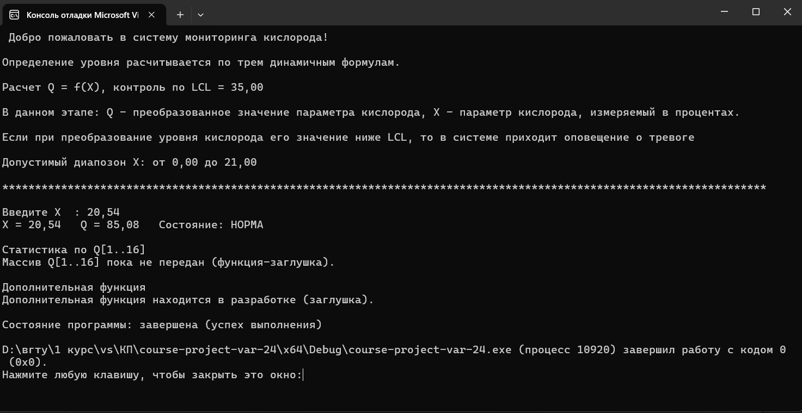

<h1>Курсовой проект: "Мониторинг реактора. Содержание кислорода" Вариант 24</h1>

## Назначение программы
Моделирование цифрового двойника технологического процесса по содержанию кислорода в реакторе. На текущем этапе программа принимает с клавиатуры показание датчика `X`, где $X \in (0; 21]$, проверяет корректность ввода, преобразует его в приведенный показатель `Q` и контролирует состояние процесса по нижней границе `LCL = 35.00`. После контроля вызываются модули-заглушки для последующего статистического анализа массива `Q[1..16]` и дополнительного функционала.

## Алгоритм работы

 

#### Условие контроля
Тип контроля: нижняя граница (`LCL = 35.00`).

| Условие | Состояние |
| :--- | :--- |
| $Q \ge LCL$ | НОРМА (`state = 0`) |
| $Q < LCL$ | ТРЕВОГА (`state = 1`) |

## Организация данных и структура программы

#### Основные переменные и константы

| Данные | Назначение | Тип данных |
| :--- | :--- | :--- |
| `x` | Текущее показание уровня кислорода, вводимое пользователем (%) | `double` |
| `q` | Приведенное значение индикатора, рассчитываемое по формуле $Q = f(X)$ | `double` |
| `state` | Текущее состояние процесса в реакторе (`0` — НОРМА, `1` — ТРЕВОГА) | `int` |
| `rc` | Код возврата функций проверки и вычисления (`RC_OK`, `RC_RANGE`, `RC_LOG_DOM`) | `int` |
| `LCL` | Нижняя граница контроля относительно `Q` (`35.00`) | `#define` |
| `X_MIN`, `X_MAX` | Границы допустимого диапазона входного параметра `X` (`0.0` и `21.0`) | `#define` |
| `X_BREAK1`, `X_BREAK2` | Границы переключения формул (`2.0` и `8.0`) | `#define` |
| `COEF1_F1` ... `COEF3_F3` | Коэффициенты расчетных формул | `#define` |
| `RC_OK`, `RC_RANGE`, `RC_LOG_DOM` | Коды состояния выполнения (`0`, `1`, `2`) | `#define` |

#### Модульная структура (функции)
* `input_x(double x)` — проверка попадания введенного значения `X` в диапазон $[0{,}0;\ 21{,}0]$.
* `convert_x_to_q(double x, double* q)` — проверка области определения логарифма ($X > 0$) и вычисление значения `Q`.
* `check_state(double q)` — сравнение `Q` с порогом `LCL` и определение состояния (`НОРМА` или `ТРЕВОГА`).
* `calc_halves_stats(const double q_values[], int n)` — функция-заглушка для расчета средних значений первой и второй половин интервала `Q[1..16]` и их разности.
* `extra_function_stub(void)` — функция-заглушка для будущего расширения функционала.

## Математическая модель и пример расчета
Расчет значений `Q` осуществляется по следующей кусочно-заданной формуле:

$$
Q(X) = \begin{cases}
4\ln(X) + 15, & 0 < X < 2 \\
(X-5)^2 + 45, & 2 \le X \le 8 \\
2(X-8) + 60, & 8 < X \le 21
\end{cases}
$$

при $X \in (0; 21]$.  
**Важное замечание:** при $X = 0$ (входящем в диапазон $[X_{\min}; X_{\max}]$) функция `convert_x_to_q` возвращает код ошибки `RC_LOG_DOM`, так как натуральный логарифм $\ln(X)$ определен только при $X > 0$.

### Пример расчета
$$
\begin{aligned}
&\text{Контрольный пример: } X = 6{,}32 \Rightarrow Q = (6{,}32 - 5)^2 + 45 = 46{,}74 \\
&\text{Пример 1: } X = 1{,}25 \Rightarrow Q = 4\ln(1{,}25) + 15 = 15{,}89 \\
&\text{Пример 2: } X = 4{,}2 \Rightarrow Q = (4{,}2 - 5)^2 + 45 = 45{,}64 \\
&\text{Пример 3: } X = 95 \Rightarrow Q \text{ не определяется, так как } X \notin (0; 21] \\
&\text{Пример 4: } X = 15{,}26 \Rightarrow Q = 2(15{,}26 - 8) + 60 = 74{,}52
\end{aligned}
$$

## Результаты работы программы

| № | Входная ситуация | Ожидаемый результат | Фактический результат | Результат |
| :-: | :--- | :--- | :--- | :-: |
| 1 | `Q` внутри границ ($X = 6{,}32$) | $Q = 46{,}74$, НОРМА | $Q = 46{,}74$, НОРМА | ✓ |
| 2 | $Q < LCL$ ($X = 1{,}00$) | $Q = 15{,}00$, ТРЕВОГА | $Q = 15{,}00$, ТРЕВОГА | ✓ |
| 3 | `X` вне диапазона ($X = 25$) | Ошибка (`RC_RANGE`) | Ошибка (`RC_RANGE`) | ✓ |
| 4 | $X \le 0$ ($X = 0{,}00$) | Ошибка (`RC_LOG_DOM`) | Ошибка (`RC_LOG_DOM`) | ✓ |
| 5 | $X = 2{,}00$ (граница участков) | $Q = 45{,}00$, НОРМА | $Q = 45{,}00$, НОРМА | ✓ |
| 6 | Вызов доп. модулей (`NULL, 0`) | Сообщения функций-заглушек | Вывод заглушек, завершение (`0`) | ✓ |

 
