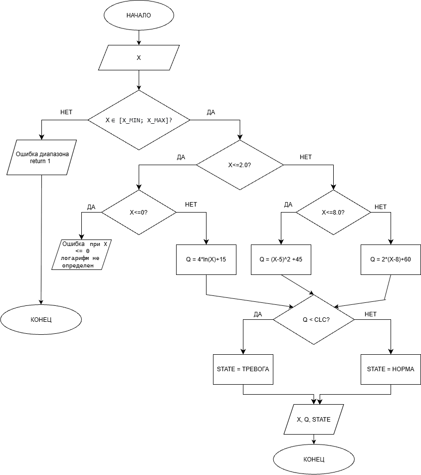
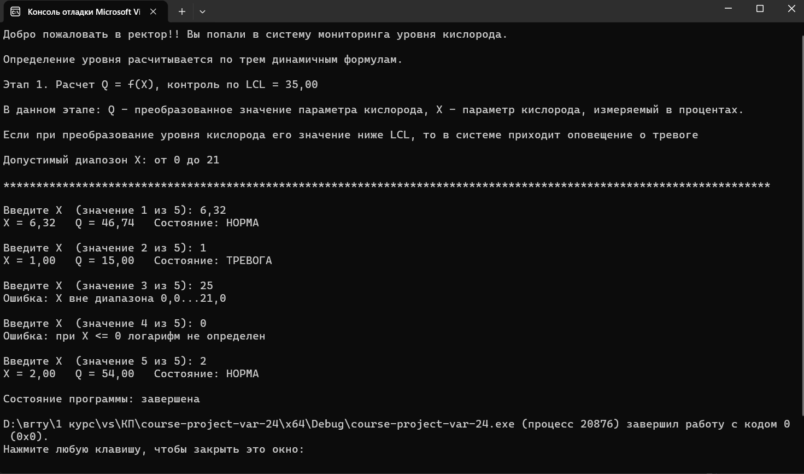

<h1>Курсовой проект: "Мониторинг реактора. Содержание кислорода" Вариант 24 </h1>

## Назначение программы
Моделирование цифрового двойника технологического процесса по содержанию кислорода в реакторе. Программа последовательно принимает показания X (0<X<21], преобразует их в Q и контролирует состояние по нижней границе LCL = 35.00.
## Алгоритм работы

 

#### Условие контроля
Тип контроля: нижняя граница (LCL = 35.00).

|Условие|Состояние|
|---|---|
|Q ≥ LCL|НОРМА|
|Q < LCL|ТРЕВОГА|

## Организация данных

|Данные|Назначение|Тип данных|
|---|---|---|
|x|текущее показание уровня кислорода вводимое пользователем (%)|double|
|Q|приведенное значение индикатора (расчитывает по формуле отталкиваясь от полученного уровня кислорода)|double|
|state|текущее состояние процесса в реакторе (НОРМА, ТРЕВОГА)|int |
|LCL|нижняя граница контроля относительно Q (35.00)|#define |
|X_MIN, X_MAX|граница диапозона x (0<x<21] |#define|
|COEF1_F1 ... COEF3_F3|коффициенты формул|#define|

## Математическая модель и пример расчета
Расчет значений Q осуществлялся по следующей формуле:  

$$
Q(X) = \begin{cases}
4\ln(X) + 15, & 0 < X < 2 \\
(X-5)^2 + 45, & 2 \le X \le 8 \\
2(X-8) + 60, & 8 < X \le 21
\end{cases}
$$

при X ∈ (0; 21]. 
ВАЖНОЕ ЗАМЕЧАНИЕ: первое уравнение принимает диапозон 0 < X < 2, так как ln всегда больше 0.
### Пример расчета
Контрольный пример: Х=6,32 ; Q=46,74 
Пример 1: Х = 1,25 → Q = 4 * ln * (1,25)+15 = 15,89 
Пример 2: Х = 4,2 → Q = (4,2 - 5)^2^ + 45 = 45,64 
Пример 3: Х = 95 → Q - не определяется, так как число Х вне допустимого диапозона (от 0 до 21) 
Пример 4: Х = 15,26 → Q = 2 * (15.26 - 8) + 60 = 74,52 

## Результаты работы программы
|№|Входная ситуация|Ожидаемый результат|Фактический результат|Результат|
|---|---|---|---|---|
|1|Q внутри границ (X = 6.32)|НОРМА|НОРМА|✓|
|2|Q < LCL (X = 1.00)|ТРЕВОГА|ТРЕВОГА|✓|
|3|X вне диапазона (X = 25)|Ошибка|Ошибка|✓|
|4|X ≤ 0 (логарифм)|Ошибка|Ошибка|✓|
|5|X = 2.00 (граница)|Q = 45.00, НОРМА|Q = 45.00, НОРМА|✓|
|6|Конец файла|Переход к статистике|-|-|

 
