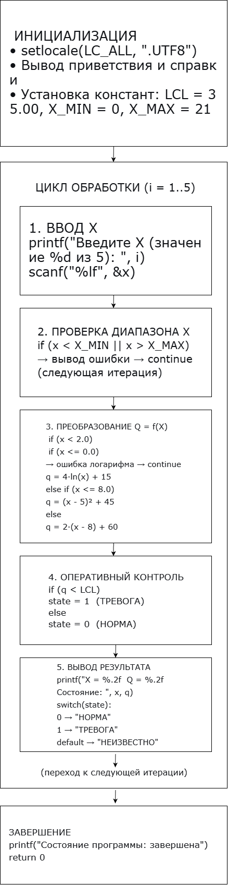
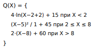
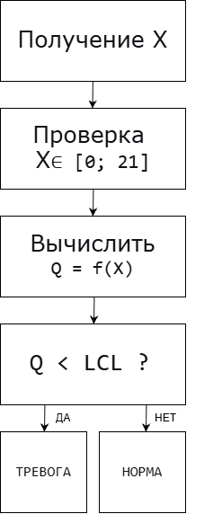
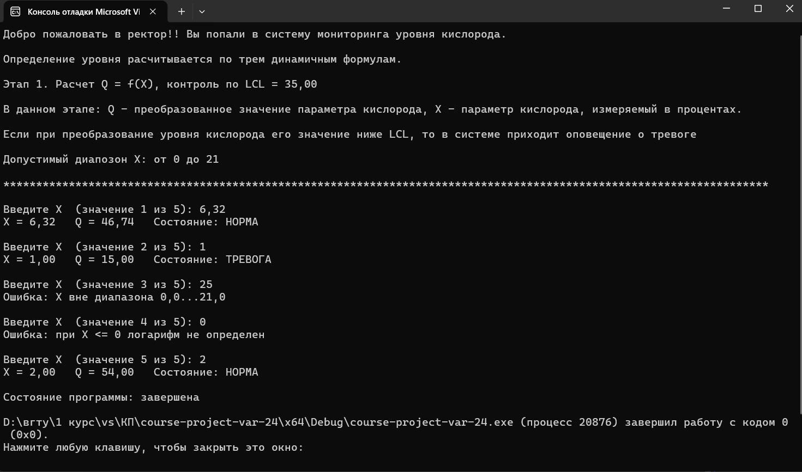

<h1>Курсовой проект. Вариант 24 </h1>

## Назначение программы
Моделирование цифрового двойника технологического процесса по содержанию кислорода в реакторе. Программа последовательно принимает показания X, преобразует их в Q и контролирует состояние по нижней границе LCL = 35.00.
## Алгоритм работы

 

## Организация данных

|Данные|Назначение|Струтктура|
|---|---|---|
|x|текущее показание датчика|double|
|Q|текущее значение индикатора|double|
|Q[]|накопленная телеметрия|статический массив double|
|state|текущее состояние процесса|int (0 — НОРМА, 1 — ТРЕВОГА)|
|LCL|нижняя граница контроля|#define LCL 35.00|
|X_MIN, X_MAX|граница диапозона Х|#define|

## Математическая модель и пример расчета
Расчет значений Q осуществлялся по следующей формуле:  

 
### Пример расчета
Контрольный пример: Х=6,32 ; Q=46,74 
Пример 1: Х=1,25 ; Q=15,89 
Пример 2: Х=4,2 ; Q= 45,64 
Пример 3: Х=95 ; Q - не определяется, так как число Х вне допустимого диапозона (от 0 до 21) 
Пример 4: Х=15,26 ; Q= 74,52 

## Алгоритм контроля и его результаты
#### Блок-схема алгоритма контроля
 

#### Условие контролыя
Тип контроля: нижняя граница (LCL = 35.00).

|Условие|Состояние|
|---|---|
|Q ≥ LCL|НОРМА|
|Q < LCL|ТРЕВОГА|

## Результаты работы программы
|№|Входная ситуация|Ожидаемый результат|Фактический результат|Результат|
|---|---|---|---|---|
|1|Q внутри границ (X = 6.32)|НОРМА|НОРМА|✓|
|2|Q < LCL (X = 1.00)|ТРЕВОГА|ТРЕВОГА|✓|
|3|X вне диапазона (X = 25)|Ошибка|Ошибка|✓|
|4|X ≤ 0 (логарифм)|Ошибка|Ошибка|✓|
|5|X = 2.00 (граница)|Q = 45.00, НОРМА|Q = 45.00, НОРМА|✓|
|6|Конец файла|Переход к статистике|-|-|

 
